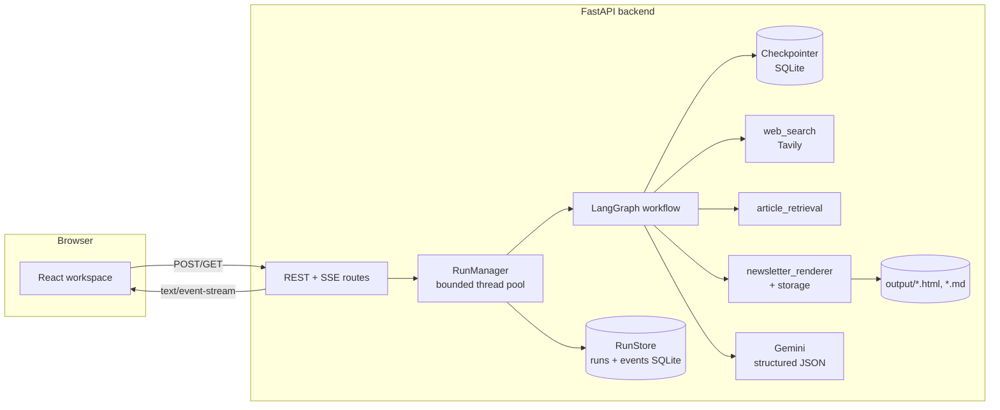
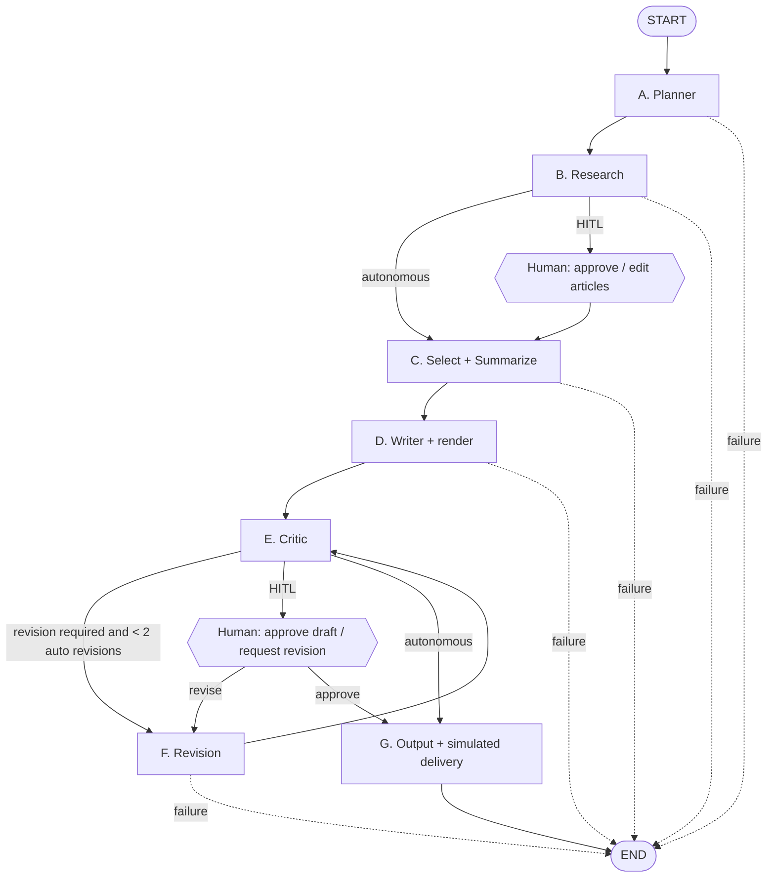
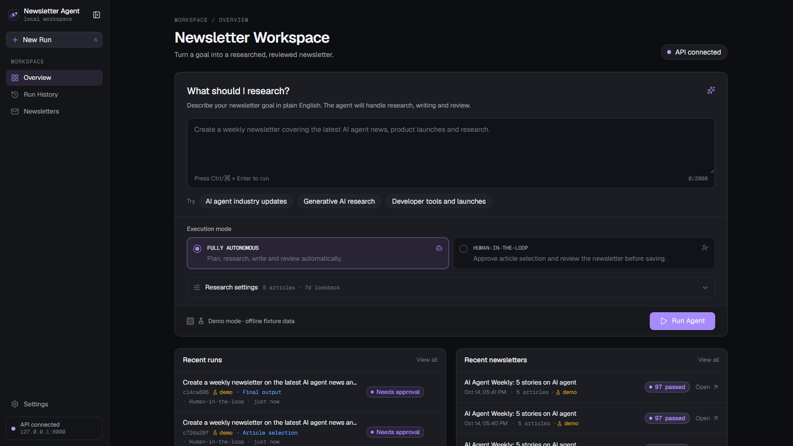
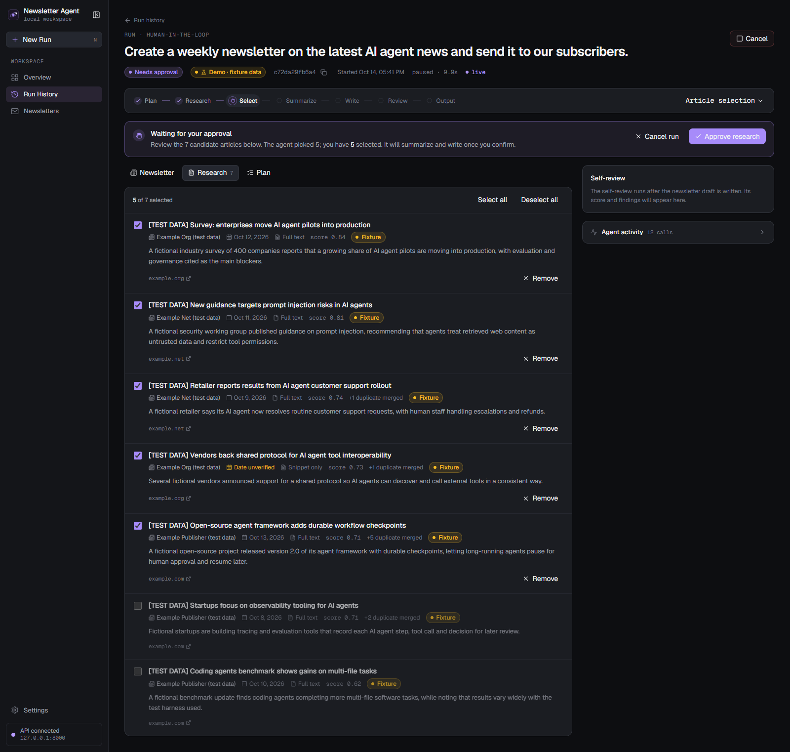
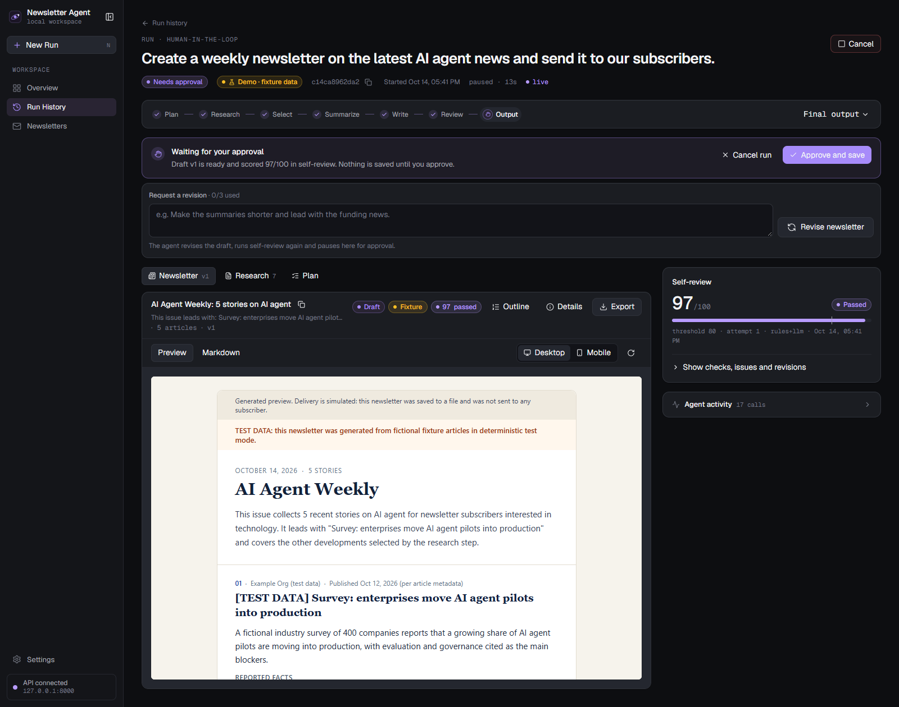
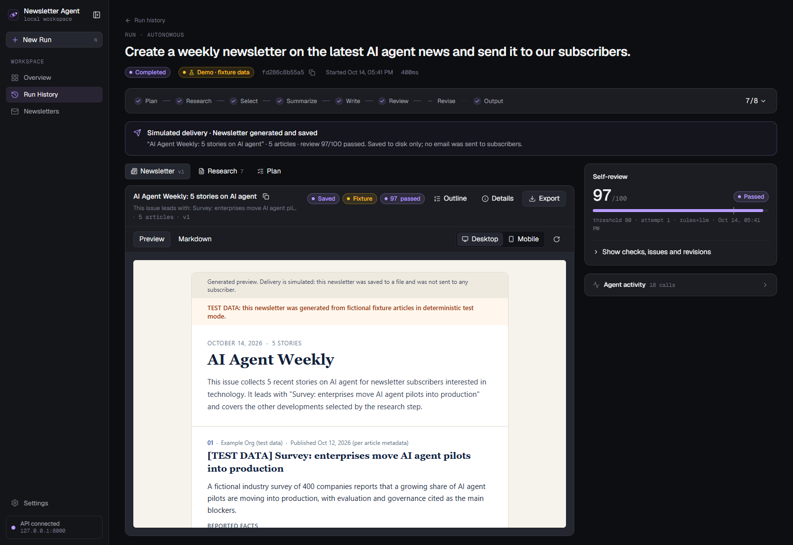
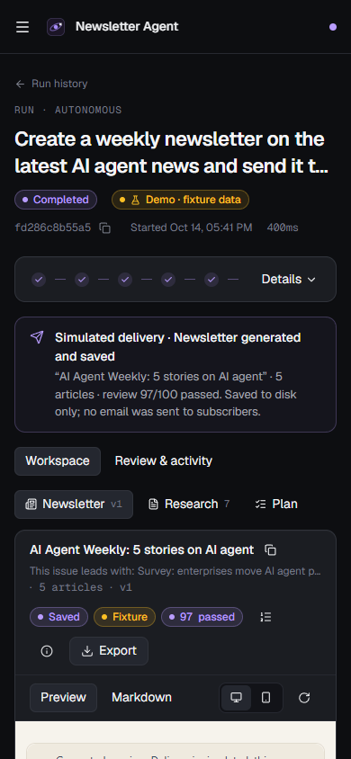

# Newsletter Agent

An autonomous AI agent that turns a plain-English goal such as

> "Create a weekly newsletter on the latest AI agent news and send it to our subscribers."

into a researched, summarized, self-reviewed newsletter (HTML + Markdown). It plans the work, searches real news with Tavily, retrieves and normalizes articles, ranks and deduplicates them, summarizes with Google Gemini, critiques its own draft against explicit quality checks, revises (max 2 automatic revisions), and saves the result. **Delivery is simulated**: files are saved and the subject/content are displayed; no email is sent.

It runs **Fully Autonomous** or **Human-in-the-Loop** (pauses for you to approve the article selection and the draft).

> New to the project? Start with **[SUBMISSION.md](SUBMISSION.md)** for the assignment checklist and the fastest no-keys run.

The frontend is a preview-first editorial workspace: a dark charcoal shell with a restrained lavender accent, a compact horizontal workflow strip, the generated newsletter as the focal surface, and a narrow review/activity rail. It is fully responsive (verified from 320 px phones to desktop).

## Features

- LangGraph workflow with typed state and explicit nodes (planner, research, selection + summarization, writer, critic, revision, output, two human gates)
- Real tools with per-call observability: Tavily web search, article retrieval/normalization, newsletter renderer + validator + storage, Gemini structured-output calls
- Structured critic: 10 weighted checks, severities, suggestions, pass/fail; critical source-integrity issues block a pass regardless of score
- Bounded revision loop with honest `completed_with_warnings` when problems remain
- Persistent Human-in-the-Loop state (LangGraph SQLite checkpointer) that survives a backend restart
- FastAPI API with Server-Sent Events, bounded thread pool, run limits, abandoned-run expiry and cleanup
- React + TypeScript + Tailwind workspace: live timeline, research selection, sandboxed preview, review breakdown, tool-call and log stream
- Deterministic test mode (labelled fixture data, no network, no keys), 86 offline tests and a browser end-to-end test
- Optional API token authentication (`API_AUTH_TOKEN`)

## Architecture



### Agent workflow



### LangGraph nodes (`backend/app/agent/nodes/`)

| Node | Responsibility |
| --- | --- |
| A `planning.py` | Validates the goal, extracts topic/audience/window/count (explicit settings win), optional Gemini refinement with heuristic fallback, builds tasks, queries and output requirements. |
| B `research.py` | Runs each query through Tavily (`topic=news`, `start_date` = lookback), normalizes results, removes duplicate URLs, scores relevance/recency/source quality, filters same-story duplicates and off-topic/out-of-window items, retrieves the top pages, re-ranks and proposes a diverse selection (max 2 per domain). |
| `human.py` research gate | HITL only: `interrupt()` until the user approves/edits the selection. |
| C `summarize.py` | Applies the selection, retrieves any not-yet-retrieved articles, summarizes with Gemini (source text in `<source>` blocks, marked untrusted). Falls back to extractive summaries if the LLM fails and records a warning. |
| D `writing.py` | Writes subject, preheader, intro and closing; builds sections whose URL/publisher/date are copied from research records (never from the LLM); renders and validates HTML + Markdown. |
| E `review.py` critic | Rule checks + Gemini critique → `ReviewResult` (score, checks, issues, severities, suggestions, pass/fail, revision_required). |
| F `review.py` revision | Sends issues + optional user feedback to Gemini, applies the copy changes, re-renders, records a `RevisionRecord` (score before/after). |
| `human.py` draft gate | HITL only: approve, or request a revision with feedback. |
| G `output.py` | Saves files with unique sanitized names, sets `completed` or `completed_with_warnings`, logs simulated delivery. |

Review scoring: weighted average of 10 checks (goal alignment, relevance, source links, duplicates, coherence, dates, HTML validity, article count, unsupported claims, structure). Pass = score ≥ 80 **and** no critical issue. Missing/invented URLs, wrong or future dates, invalid HTML, prompt-injection text, and claims that the email was sent are critical.

### Tools

| Tool | Module | Notes |
| --- | --- | --- |
| Web search | `tools/web_search.py` | Tavily REST API with retries for 429/5xx, typed errors with a recovery hint. Never fabricates results. |
| Article retrieval + normalization | `tools/article_retrieval.py` | Canonical URLs (tracking params stripped), publisher names, date parsing (future dates rejected), SSRF-guarded page fetch (public IPs only, size/time limits, manual redirects), stdlib HTML extraction of paragraphs + `article:published_time`/JSON-LD dates. Falls back to the search snippet and records `content_basis="search_snippet"`. |
| Newsletter renderer | `tools/newsletter_renderer.py` | Email-safe table layout, inline CSS, no JS or remote assets, all text escaped, only http(s) links, document validator. |
| Storage | `storage/local.py` | Exclusive-create writes, collision suffixes, path-traversal-safe `resolve()`. Swap for S3/GCS by implementing `NewsletterStorage`. |

Every tool and LLM call records name, input summary, status (`success`/`fallback`/`error`), start/end timestamps, duration, result summary and error. Messages pass through a redactor that strips anything resembling an API key.

## Autonomous vs Human-in-the-Loop

- **Fully Autonomous**: one call runs plan → research → summarize → write → review → revise → save with no pauses.
- **Human-in-the-Loop**: the graph calls LangGraph `interrupt()` after research and after review. The run's state is persisted in `backend/data/checkpoints.sqlite`; status becomes `awaiting_research_approval` / `awaiting_draft_approval`. It continues only when you call the approve/revise endpoint (the UI buttons do this). Nothing is auto-approved. Paused runs expire after `APPROVAL_TTL_HOURS` (default 24).

## Prerequisites

- Python 3.11+
- Node.js 20.19+ or 22.12+ (tested with Node 24)
- For live runs: a [Gemini API key](https://aistudio.google.com/apikey) and a [Tavily API key](https://app.tavily.com) (Tavily has a free tier)

## Local setup

### Windows PowerShell

```powershell
# Backend
cd backend
python -m venv .venv
.venv\Scripts\Activate.ps1
pip install -r requirements-dev.txt
Copy-Item ..\.env.example .env      # then edit .env and add your keys
uvicorn app.main:app --reload --port 8000

# Frontend (second terminal)
cd frontend
npm install
Copy-Item .env.example .env.local
npm run dev                          # http://127.0.0.1:5173
```

### macOS / Linux

```bash
cd backend
python3 -m venv .venv && source .venv/bin/activate
pip install -r requirements-dev.txt
cp ../.env.example .env              # add your keys
uvicorn app.main:app --reload --port 8000

cd ../frontend
npm install && cp .env.example .env.local
npm run dev
```

The backend reads `backend/.env` or the repository-root `.env`. Without keys the app still runs; the UI switches to deterministic test mode and `/api/health` reports `live_mode_available: false`.

### Running the agent from Python

```python
# from backend/
from newsletter_agent import run_newsletter_agent, RunOptions

result = run_newsletter_agent("Create a weekly newsletter on latest AI agent news and send it to our subscribers.")
print(result.status, result.subject, result.html_path)

offline = run_newsletter_agent("Create a weekly newsletter on AI agents", RunOptions(deterministic=True))
```

Or from the command line (HITL prompts you in the terminal):

```bash
python -m app.cli "Create a weekly newsletter on AI agent news"            # live
python -m app.cli --deterministic --mode hitl                               # offline, asks you to approve
```

## Tests

```bash
cd backend
pytest                       # 86 offline tests, no keys or network
RUN_LIVE_TESTS=1 pytest -m live    # opt-in real Tavily + Gemini run (PowerShell: $env:RUN_LIVE_TESTS="1"; pytest -m live)
```

Coverage includes goal validation, planner output, Tavily parsing (mocked HTTP), URL and story deduplication, missing/future dates, mocked-LLM summarization and malformed-JSON retry, HTML/Markdown rendering, escaping and link sanitization, critic detection of missing sources/wrong dates/unsupported numbers, the revision loop and its limit, saving and write failures, path traversal, autonomous completion, HITL pause/approval/revision/cancel at graph and HTTP level, restart persistence/recovery and expiry, atomic queued cancellation, retention artifact deletion, chunked request-size enforcement, authentication, capacity limits, status/result/file endpoints, SSE, and health without keys. `.github/workflows/ci.yml` runs the backend suite, frontend production build and deterministic browser E2E on pushes and pull requests.

### Deterministic test mode

Enable per run (UI checkbox or `"deterministic": true`), or globally with `DETERMINISTIC_MODE=true`. It uses `app/tools/fixtures.py`: fictional articles on reserved `example.*` domains, titled `[TEST DATA] …`, including deliberate duplicates, an old article, an off-topic article, an undated article and a simulated paywall. Writing is rule-based and extractive. Output is labelled as test data in the UI, HTML and Markdown. It is never presented as real news.

## API

Base URL `http://127.0.0.1:8000`. Interactive docs at `/docs`.

| Method | Path | Description |
| --- | --- | --- |
| GET | `/api/health` | Health + configuration status (no secrets). |
| GET | `/api/agent/runs?limit=20` | Recent runs. |
| POST | `/api/agent/runs` | Start a run. Body: `goal` (required), `mode` (`autonomous` \| `human_in_the_loop`), `topic`, `audience`, `article_count` (3–7), `lookback_days` (1–31), `deterministic`. Returns 202 + run detail. 422 invalid input, 503 missing keys for live mode, 429 at capacity. |
| GET | `/api/agent/runs/{id}` | Status, stages, current stage, plan, candidates, draft, review, revisions, logs, tool calls, metrics. |
| GET | `/api/agent/runs/{id}/events` | SSE stream (`log`, `tool_call`, `stage`, `status`, `artifact`, `end`). Supports `Last-Event-ID` / `?after=`. |
| GET | `/api/agent/runs/{id}/result` | Final `NewsletterResult` (409 until finished). |
| POST | `/api/agent/runs/{id}/approve-research` | Body `{"selected_ids": [...]}` (1–7 ids from candidates; omit to accept proposal). |
| POST | `/api/agent/runs/{id}/approve-newsletter` | Approve the draft; the run saves the files. |
| POST | `/api/agent/runs/{id}/revise` | Body `{"feedback": "..."}`; limited to `MAX_USER_REVISIONS` (3). |
| POST | `/api/agent/runs/{id}/cancel` | Cancel a queued, running or paused run (409 if finished). |
| GET | `/api/agent/runs/{id}/newsletter.html` | Saved HTML (strict CSP with `sandbox`). `?download=true` for attachment. |
| GET | `/api/agent/runs/{id}/newsletter.md` | Saved Markdown. |

## Output files

Saved to `backend/output/` (override with `OUTPUT_DIR`) as `YYYYMMDD-HHMMSS-<title-slug>-<runid8>.html` and `.md`. Run state lives in `backend/data/` (`runs.sqlite`, `checkpoints.sqlite`). Both directories are git-ignored.

## Deployment

### Backend on Render

1. Push the repo to GitHub.
2. In Render, create a Blueprint from `render.yaml` (or a Web Service with root `backend`, build `pip install -r requirements.txt`, start `uvicorn app.main:app --host 0.0.0.0 --port $PORT`).
3. Set `GEMINI_API_KEY`, `TAVILY_API_KEY` and `CORS_ORIGINS=https://<your-frontend>.vercel.app` in the dashboard. `API_AUTH_TOKEN` is generated by the Blueprint; copy it from the dashboard into the app's Settings dialog.
4. Keep the persistent disk mounted at `/var/data` (requires a paid instance). Without a disk, generated files and paused HITL runs are lost on each deploy/restart.
5. Health check: `/api/health`.

A `backend/Dockerfile` is included for container hosts.

### Frontend on Vercel

1. Import the repo, set the root directory to `frontend` (Vite is auto-detected; `vercel.json` is included).
2. Add `VITE_API_BASE_URL=https://<your-backend>.onrender.com` (the older `VITE_API_URL` is still accepted as a fallback).
3. Deploy. The value is baked in at build time, so redeploy after changing it.

`frontend/Dockerfile` builds a static nginx image as an alternative.

### Scaling notes (checkpoint store)

The checkpointer and run store are local SQLite files. That is reliable for a single instance, but a multi-instance deployment needs:

- a shared checkpointer, e.g. `langgraph-checkpoint-postgres` (`PostgresSaver`) instead of `SqliteSaver`,
- `RunStore` moved to Postgres (or Redis for events),
- a work queue (e.g. Redis/RQ, Celery) instead of the in-process thread pool, so any instance can resume a paused run,
- object storage (S3/GCS) for output files via a new `NewsletterStorage` implementation.

## Security considerations

- Secrets only in backend env vars; `/api/health` exposes booleans, never values; logs are redacted.
- Explicit CORS allowlist, `allow_credentials=False`, actual streamed request body limit (64 KB; not dependent on `Content-Length`), Pydantic validation with `extra="forbid"`.
- Run ids are validated (32 hex chars); file endpoints serve only paths recorded for that run and resolved inside the output directory.
- Newsletter HTML: all text escaped, only http(s) links, no scripts/iframes/remote resources, validated before saving; served with a `sandbox` CSP and shown in an `<iframe sandbox="">` (no scripts, no same-origin).
- Retrieved web content is treated as data: wrapped in `<source>` blocks, system prompts forbid following embedded instructions, the LLM has no tools, source URLs/dates are never taken from LLM output, and the critic flags injection-like text.
- Page retrieval blocks private/loopback addresses (SSRF guard) and limits size, time and redirects.
- Bounded concurrency, atomic queued→running status transitions, queue size, retries, query count, run time (`MAX_RUN_SECONDS`) and revision counts. Retention cleanup removes run rows, checkpoints and their HTML/Markdown artifacts.
- Shared-token auth: set `API_AUTH_TOKEN` and every `/api` route except `/api/health` requires `Authorization: Bearer <token>` (or `X-API-Key`). Production refuses to start without a token. The UI keeps it in `sessionStorage` for the tab only; authenticated fetch is used for JSON, SSE and file downloads, so the token never appears in URLs. `render.yaml` generates a random token. This is a single shared secret, not per-user accounts.

## Known limitations

- Live mode is verified with real Tavily and Gemini (`gemini-2.5-flash`): `pytest -m live` and `E2E_LIVE=1 npm run e2e` both pass. Newer models can be overloaded (`gemini-3.8-flash` returned 504/503 "high demand" during testing).
- Gemini free-tier quotas are small and per model (e.g. 20 requests/day for `gemini-2.5-flash` on a free key at the time of testing; one run uses ~4–8 requests). The client reads the quota details from the 429 response: per-minute limits are retried after the server-provided delay; a used-up daily quota marks that model as exhausted until reset and switches to the next entry in `GEMINI_FALLBACK_MODELS`. If every model is exhausted, the run still completes with extractive summaries and a clear warning instead of failing. Use a paid key for regular use.
- Relevance ranking is keyword-based; occasionally a loosely related story (e.g. general AI commentary) ranks into the selection. Human-in-the-Loop mode lets you remove it.
- "Fact checking" is limited to what the tools verify: URLs match researched records, dates come from the search API or page metadata, numbers in summaries must appear in the source text, plus the LLM critic's judgement. It does not independently verify the reporting.
- Many news sites block bots or render with JavaScript; those stories are summarized from search snippets and labelled as such.
- Tavily's `published_date` is a best estimate and may reflect an update date.
- Cancellation is cooperative: it takes effect between tool calls, not in the middle of an LLM request.
- Single-instance state (see scaling notes). Authentication is a single shared token, not per-user accounts.

## Project structure

```
backend/
  app/
    main.py                 FastAPI app, CORS, body limit
    config.py               Settings from env
    api/                    routes.py (REST + SSE), schemas.py, auth.py (optional token)
    agent/                  graph.py, state.py, runner.py (run_newsletter_agent), planner.py,
                            critic.py, llm_tasks.py, services.py, prompts/, nodes/
    tools/                  web_search.py, article_retrieval.py, newsletter_renderer.py, fixtures.py
    services/               llm.py, ranking.py, telemetry.py, run_manager.py, run_store.py
    storage/                base.py, local.py
    cli.py
  tests/                    pytest suite (offline) + opt-in live test
  newsletter_agent.py       `from newsletter_agent import run_newsletter_agent`
frontend/
  src/                      components/, pages/, hooks/, services/, types/, styles/
scripts/                    ui-e2e.mjs (browser E2E), capture-screenshots.mjs
docs/screenshots/           captured UI screenshots
render.yaml  .env.example  .gitignore
```

## Verification snapshot

Verified locally on October 14, 2026:

- `pytest -p no:cacheprovider`: **86 passed**, 1 opt-in live test deselected
- `RUN_LIVE_TESTS=1 pytest -m live`: real Tavily + Gemini workflow passed, including critic-triggered revision
- `npm run build`: TypeScript and Vite production build passed (JS 89.64 KB gzip; self-hosted Latin font subsets)
- deterministic and live `npm run e2e`: autonomous, HITL selection edit, revision, approval, download and cancellation passed in Chrome
- backend and frontend Docker images built; production containers passed health, authentication, security-header and root-page smoke tests
- `npm audit` (frontend and browser scripts): 0 vulnerabilities; `pip check`: no broken requirements

## Browser end-to-end test and screenshots

`scripts/` drives the real UI in headless Chrome/Edge (puppeteer-core, uses your installed browser) against running servers:

```bash
cd scripts && npm install
npm run e2e          # clicks Run Agent, removes an article, approves, requests a revision, approves, cancels
npm run screenshots  # regenerates docs/screenshots/*.png
E2E_LIVE=1 npm run e2e   # same flow against real Tavily + Gemini (needs keys on the backend)
```

## Screenshots

Captured from the running app in deterministic test mode (fixture data, labelled as such).

| Workspace | Human-in-the-Loop: article approval |
| --- | --- |
|  |  |

| Human-in-the-Loop: draft review | Completed run | Mobile |
| --- | --- | --- |
|  |  |  |
